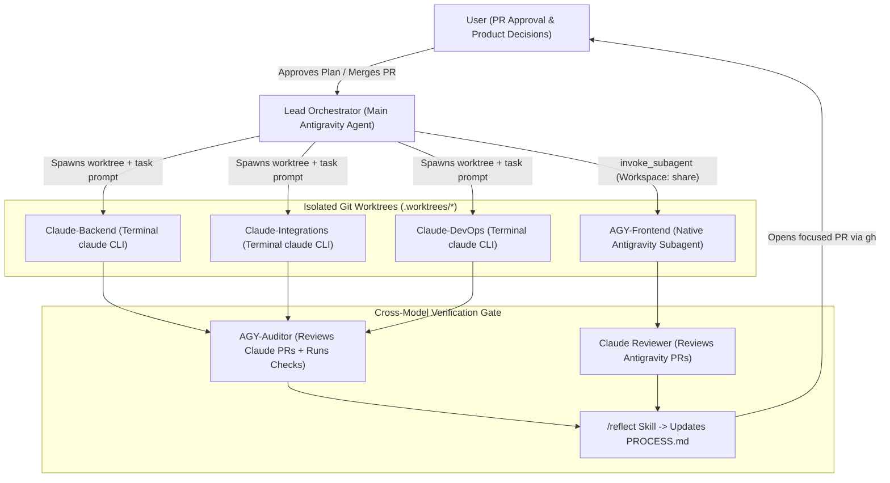

# Multi-Agent Execution Plan: Hardware & Machining Prototyping Assistant

This plan organizes development of the **E190 Hardware & Machining Prototyping Assistant** across **native Antigravity agents** and **terminal Claude Code (`claude` CLI) agents**, strictly enforcing every constraint in [CLAUDE.md](file:///Users/nathannoronha/E190BO-FINAL-PROJECT/E190-Final-Project/CLAUDE.md). No application code has been written yet.

---

## 1. Current Environment Assessment & Phase 0 Prerequisites

Before dispatching worker agents, a few quick environment alignments will make multi-agent execution smooth:

1. **Set Active Workspace in Antigravity**: Open `/Users/nathannoronha/E190BO-FINAL-PROJECT/E190-Final-Project` as your active workspace folder so Antigravity subagents inherit sandbox read/write access and auto-discover project rules/skills.
2. **Clean Initial Git State**: The repo is currently on branch `add-claude-md` with [CLAUDE.md](file:///Users/nathannoronha/E190BO-FINAL-PROJECT/E190-Final-Project/CLAUDE.md) committed and `README.md` unstaged-deleted. We should restore/update `README.md`, merge `add-claude-md` into `main` via PR, and branch all slices cleanly from `main`.
3. **Install GitHub CLI (`gh`)**: Run `brew install gh && gh auth login` so both Antigravity and Claude Code agents can open focused PRs and attach cross-model review comments directly from the terminal.
4. **Dual-Harness Shared Context**:
   - Mirror [CLAUDE.md](file:///Users/nathannoronha/E190BO-FINAL-PROJECT/E190-Final-Project/CLAUDE.md) to `AGENTS.md` (via symlink) so native Antigravity subagents automatically load the exact same rules that Claude Code loads from `CLAUDE.md`.
   - Author the `/reflect` skill in **both** `.claude/commands/reflect.md` (for Claude Code) and `.agents/skills/reflect/SKILL.md` (for Antigravity) so either harness can log design decisions, test results, and user interview notes to `PROCESS.md`.

---

## 2. Multi-Agent Roster & Division of Labor

Deploying **two distinct model families** (Antigravity Gemini/Argon models + Anthropic Claude Code CLI `v2.1.101`) unlocks **true cross-model adversarial review**: no model reviews its own code.

| Agent ID | Harness & Execution Mode | Primary Responsibility | Why This Harness Fits |
| :--- | :--- | :--- | :--- |
| **Lead Orchestrator** | **Main Antigravity Agent** (this chat) | Owns task graph, manages `git worktree` branches, dispatches subagents & `claude` tasks, synthesizes `PROCESS.md`, and pauses at every PR gate for your approval. | Persistent conversation state, native subagent & background task coordination (`invoke_subagent`, `run_command`). |
| **Claude-Backend** | **Claude Code CLI** (`/usr/local/bin/claude` in terminal worktree) | FastAPI app structure, SQLModel schemas (`Student` / `Steward` roles, projects, steps, safety sign-offs, inventory), Postgres transaction commits, CRUD routers, `pytest` suite. | Strong at Python/FastAPI/SQLModel backend invariants and multi-file test-driven iteration in CLI loops. |
| **AGY-Frontend** | **Native Antigravity Subagent** (`define_subagent`: `frontend-artisan`) | Semantic HTML5 (`<main>`, `<article>`, `<section>`, `<dialog>`), stark black-and-white rustic Greek CSS system (serif headings, monospace technical readouts), mobile-first layout, vanilla JS UI state. | Strong visual/design sensibility, strict semantic markup generation, and native UI/DOM inspection capabilities. |
| **Claude-Integrations** | **Claude Code CLI** (`/usr/local/bin/claude` in terminal worktree) | Explicit-trigger-only LLM service (step breakdown + project chat, timeout/error envelopes, mockable client) + clean placeholder interfaces for bulk CSV upload and the TBD third-party API. | Clean service-layer abstraction, strict error contract handling, and mocked integration testing. |
| **AGY-Auditor** | **Native Antigravity Subagent** (`define_subagent`: `qa-auditor`) | Automated compliance gate against [CLAUDE.md](file:///Users/nathannoronha/E190BO-FINAL-PROJECT/E190-Final-Project/CLAUDE.md): checks zero `
` soup, zero page-load LLM calls, `os.getenv` secret hygiene, DB commit persistence, and reviews Claude-authored PRs. | Fast, deterministic checklist verification in an isolated read/test context before human PR review. |
| **Claude-DevOps & Reviewer** | **Claude Code CLI** (`/usr/local/bin/claude` in terminal worktree) | `Dockerfile`, `docker-compose.yml` (local Postgres), Railway config (`railway.toml`/healthchecks), plus cross-model code review on `AGY-Frontend` PRs. | Strong container/deployment debugging and independent second-opinion PR review. |

---

## 3. Orchestration Topology & Collision-Free Git Protocol

> [!IMPORTANT]
> **Respecting Small Slices & Human PR Gating**: Parallel agents must never dump a monolithic codebase or overwrite each other's files. Every slice runs in an isolated **`git worktree`** (`.worktrees/slice-N-<name>`), touches bounded directories, passes **Cross-Model Review**, logs to `PROCESS.md`, and **waits for your explicit PR approval** before merging to `main`.

### Two Supported Ways to Run Terminal Claude Code Agents
1. **Automated Headless Dispatch**: The Lead Orchestrator runs `claude -p "<slice prompt>" --allowedTools "Read,Edit,Write,Bash"` inside `.worktrees/<slice>` via background terminal tasks and wakes automatically when Claude finishes. *(Requires one-time network approval outside the sandbox).*
2. **Interactive Terminal Co-Pilot**: The Lead Orchestrator prepares the git worktree and writes a scoped `TASK_BRIEF.md`, and you run interactive `claude` in a split terminal tab when you want live visibility into Claude's reasoning.

### Strict File-Ownership Boundaries (Enabling Safe Parallelism)
Once **Slice 1** locks the API/schema contract, Backend and Frontend agents can work simultaneously in separate worktrees without merge conflicts:
- **Backend / Integrations (`Claude-Backend`, `Claude-Integrations`)**: `app/models/`, `app/routers/`, `app/services/`, `app/integrations/`, `tests/backend/`
- **Frontend (`AGY-Frontend`)**: `app/static/css/`, `app/static/js/`, `app/templates/` (or `app/static/*.html`), `tests/frontend/`
- **Infra (`Claude-DevOps`)**: `Dockerfile`, `docker-compose.yml`, `railway.toml`, `.env.example`

---

## 4. Vertical Slice Roadmap (PR-by-PR Plan)

Each slice below equals **one focused Pull Request** waiting for your review and approval before merge.

### Slice 0: Harness Alignment, Repo Hygiene & `/reflect` Skill
- **Assigned To**: `Lead Orchestrator` + `AGY-Auditor` (verification)
- **Scope**:
  - Restore & write concise project `README.md`; add Python/Docker/worktree `.gitignore` and `.env.example` (`DATABASE_URL`, `LLM_API_KEY`, `APP_SECRET_KEY` via `os.getenv`).
  - Symlink `AGENTS.md` -> `CLAUDE.md`.
  - Create `/reflect` skill for both Claude Code (`.claude/commands/reflect.md`) and Antigravity (`.agents/skills/reflect/SKILL.md`), and initialize `PROCESS.md` with initial architecture entry.
- **PR Gate #0**: Merge baseline harness setup to `main`.

---

### Slice 1: Database Schema, Role Persistence & Local Dockerized Postgres
- **Assigned To**: `Claude-Backend` + `Claude-DevOps` (Reviewed by `AGY-Auditor`)
- **Scope**:
  - FastAPI application skeleton (`app/main.py`, `app/database.py` using `os.getenv("DATABASE_URL")`) + `/health` endpoint.
  - SQLModel persistent schemas supporting **`Student`** and **`Steward`** roles:
    - `User` (`id`, `name`, `email`, `role: RoleEnum[STUDENT, STEWARD]`)
    - `Project` (`id`, `student_id`, `title`, `description`, `status`, `created_at`)
    - `ProjectStep` (`id`, `project_id`, `step_order`, `title`, `instructions`, `requires_steward_signoff`, `safety_approved_by`, `safety_approved_at`)
    - `InventoryItem` (`id`, `sku`, `name`, `category`, `location`, `quantity`, `unit`, `updated_by`)
  - `Dockerfile` (Railway-optimized, `$PORT`-aware) + `docker-compose.yml` with persistent Postgres volume.
  - `pytest` persistence tests verifying explicit `.commit()` durability across session teardowns.
- **PR Gate #1**: Lock database & API contract on `main`. *(Unlocks parallel work for Slices 2, 3A, and 5A!)*

---

### Slice 2: Stark Greek Design System & Mobile-First Semantic Shell
- **Assigned To**: `AGY-Frontend` (Reviewed by `Claude-DevOps & Reviewer`)
- **Can Run in Parallel With**: Slice 3 backend prep (once Slice 1 contract is defined)
- **Scope**:
  - Stark, utilitarian black-and-white Greek aesthetic (`tokens.css`, `layout.css`): high-contrast `#000`/`#FFF` palette, classical serif headings (e.g., Cormorant/EB Garamond or system serif stack), crisp monospace readouts for tolerances/stock quantities/safety badges, classical rule borders (`1px`/`2px` solid lines, architectural proportions).
  - Pure semantic HTML5 structure (`<header>`, `<nav>`, `<main>`, `<section>`, `<article>`, `<aside>`, `<dialog>`, `<footer>`) — **zero `
` soup**, tested down to `320px–390px` mobile viewports.
  - Role context bar (`Student` view vs. `Steward` view) + static navigation shell.
  - **Strict check**: Zero LLM calls or background generation requests on `DOMContentLoaded` / page load.
- **PR Gate #2**: Visual & mobile responsiveness review before wiring dynamic flows.

---

### Slice 3: Student Project Breakdown & Explicit-Trigger LLM Assistant
- **Assigned To**: `Claude-Integrations` (API + LLM service) + `AGY-Frontend` (Form & Step Reader UI), audited by `AGY-Auditor`
- **Scope**:
  - Backend LLM service (`app/services/llm.py`) using `os.getenv` credentials:
    - `POST /api/projects` (creates project) and explicit user-triggered `POST /api/projects/{id}/generate-steps` + `POST /api/projects/{id}/chat` (refines machining steps or answers tooling questions).
    - **CRITICAL Enforcement**: No GET endpoint or page render ever invokes the LLM; only explicit `POST` user actions trigger model calls.
    - Structured failure handling (timeouts, rate limits, missing API key, upstream 5xx) returning honest, actionable error payloads.
  - Frontend student submission `<form>` and step-by-step `<article>` reader + chat `<section>` with explicit loading indicators and stark, honest network failure banners (with retry button, never silent failure).
- **PR Gate #3**: Verify LLM trigger discipline, failure states, and DB persistence of generated steps.

---

### Slice 4: Shop Steward Safety Check-Off Workflow
- **Assigned To**: `Claude-Backend` (role-guarded endpoints) + `AGY-Frontend` (Steward queue & safety badges), cross-reviewed
- **Scope**:
  - Role-enforced Steward endpoints (`POST /api/steps/{step_id}/approve-safety`, `POST /api/steps/{step_id}/flag-safety`, `GET /api/steward/pending-signoffs`) verifying `Steward` role and committing steward attribution + timestamp.
  - Mobile-friendly Steward check-off queue (designed for a steward walking the shop floor with a phone) and high-contrast safety lock indicators on Student project steps requiring sign-off (e.g., lathe, mill, laser cutter, bandsaw).
- **PR Gate #4**: End-to-end Student -> Steward sign-off walkthrough.

---

### Slice 5: Makerspace Inventory & Pending Integration Placeholders
- **Assigned To**: `Claude-Backend` + `Claude-Integrations` + `AGY-Frontend`, audited by `AGY-Auditor`
- **Scope**:
  - Stockroom/makerspace inventory endpoints & semantic mobile table/card list: students can search/check stock availability; stewards can add/adjust stock quantities with durable Postgres commits.
  - **Placeholder #1 — Bulk CSV Inventory Upload**: Clean `POST /api/inventory/upload-csv` stub returning `501 Not Implemented` (with documented schema expectations and parser hook interface in `app/integrations/csv_import.py`) + clearly labeled Steward UI placeholder panel pending steward workflow interviews.
  - **Placeholder #2 — Third-Party API Integration**: Clean adapter protocol/ABC in `app/integrations/external_provider.py` + config hook (`EXTERNAL_API_KEY`, `EXTERNAL_API_BASE_URL`) wired into dependency injection without live external coupling.
- **PR Gate #5**: Review inventory workflow and verify clean extensibility of both placeholders.

---

### Slice 6: Automated Compliance Suite, Restart Durability & Railway Readiness
- **Assigned To**: `AGY-Auditor` + `Claude-DevOps` + `Lead Orchestrator`
- **Scope**:
  - Automated compliance test suite (`tests/test_directives.py`) asserting:
    1. HTML templates contain semantic landmarks and pass mobile/accessibility checks.
    2. Page-load routes (`GET /`, `GET /api/projects`, etc.) make **zero** calls to the LLM client (verified via monkeypatch spy).
    3. Data written by `Student` and `Steward` flows survives container restart against Postgres.
    4. Zero tracked secrets in git history.
  - Final Railway deployment verification (`Dockerfile`, startup command, Postgres `DATABASE_URL` normalization for `postgresql://`) and comprehensive `PROCESS.md` update via `/reflect`.
- **PR Gate #6**: Final release review.

---

## 5. Automated Guardrails Checked on Every Slice

Before **any** agent opens a PR for your review, `AGY-Auditor` and `Claude-Reviewer` must pass this 6-point gate:

- [ ] **No Page-Load LLM Calls**: Spy test confirms `0` LLM invocations on all `GET` / initial load paths.
- [ ] **Honest Failure UX**: Simulated LLM disconnect displays an explicit user-facing error state.
- [ ] **Semantic Mobile-First HTML**: Landmarks (`<main>`, `<article>`, `<section>`) used properly; usable at `375px` width; stark B&W Greek aesthetic preserved.
- [ ] **Role & Commit Integrity**: `Student` cannot approve safety steps; all `POST`/`PATCH` mutations commit cleanly to Postgres.
- [ ] **Secret Hygiene**: `git diff` scanned for hardcoded keys/URLs; all configs read via `os.getenv`.
- [ ] **Process Reflection**: `/reflect` run to append slice summary & test results to `PROCESS.md`.

---

## 6. Open Decisions to Confirm Before Slice 0

1. **Authentication / Role Switching Depth**: For this prototype, should user identity + `Student`/`Steward` role selection be a **persistent DB-backed user switcher / Steward passcode** (fast to test on mobile in shop interviews), or full **email + password session auth**?
2. **Target LLM Provider for the App Backend**: Which API will the FastAPI app call for machining step breakdowns (`ANTHROPIC_API_KEY` Claude API, `GEMINI_API_KEY` Gemini API, or `OPENAI_API_KEY`)? *(We can wrap it behind a provider-agnostic interface using `os.getenv`).*
3. **Claude Code Dispatch Preference**: Would you like me (the Lead Orchestrator) to **spawn headless `claude -p` tasks automatically** inside `.worktrees/*`, or would you prefer to **run interactive `claude` yourself in a split terminal** from task briefs I generate (or both)?
